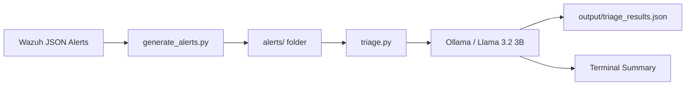

# AI-Augmented SOC Alert Triage Pipeline

## Executive Summary

This project generates synthetic Wazuh-format security alerts and sends them to a locally hosted Llama model through Ollama for preliminary triage. It summarizes the observed activity, suggests a MITRE ATT&CK technique when supported by evidence, and assigns a preliminary severity. For enterprise security teams, this demonstrates how local AI can help analysts process alert queues while keeping alert data on the workstation. It also highlights the need to validate model output because missed context, false positives, and detection gaps can affect triage decisions.

## Architecture Diagram



## Technologies Used

- Infrastructure: Local machine
- OS: Windows
- Language: Python 3
- LLM: Llama 3 via Ollama (local, no API key required)
- EDR Format: Wazuh
- Framework: MITRE ATT&CK

A classroom purple-team demonstration that sends synthetic Wazuh-style alerts to a local Ollama model for preliminary triage. No real telemetry or external LLM service is used. Model output is advisory and requires analyst review.

## Structure

```text
soc-triage-pipeline/
├── README.md
├── requirements.txt
├── alerts/
├── output/
├── src/
│   ├── generate_alerts.py
│   ├── triage.py
│   └── prompts.py
└── docs/
    └── report.md
```

## Requirements and setup

- Python 3.10 or later
- Ollama installed and running locally
- Llama 3.2 3B model available to Ollama
- The only Python package dependency is `ollama` (listed in `requirements.txt`); no API key is required because requests go to the local Ollama service.

From this directory, run:

```bash
python -m venv .venv
# Windows: .venv\Scripts\activate
# macOS/Linux: source .venv/bin/activate
python -m pip install -r requirements.txt
ollama pull llama3.2:3b
python src/generate_alerts.py
```

Make sure the Ollama app is running, then in the same terminal, from this directory, run `python src/triage.py`. The script uses model name `llama3.2:3b`. This smaller Llama 3 family model is selected because the 8B `llama3:latest` model could not finish loading on the tested 8 GB RAM CPU-only PC, while the 1B variant produced inconsistent triage decisions.

### Windows PowerShell

Run these commands from the repository folder. If `python` is not on `PATH` but Python 3.12 was installed for the current user, use the executable path shown below in place of `python`:

```powershell
python -m venv .venv
.\.venv\Scripts\Activate.ps1
python -m pip install -r requirements.txt
ollama pull llama3.2:3b
python src\generate_alerts.py
python src\triage.py
```

If PowerShell cannot find `python`, try `py -3` in its place, or use the full path to the installed `python.exe`. The Ollama desktop app or service must be running before the triage command. The generator prints each alert as it creates it; triage prints each model result and writes the detailed results JSON under `output/`.

## Sample data

The generator creates 20 fictional alerts using the requested Wazuh fields plus the required `alert_type` benchmark label. Each file contains only those fields; `alert_type` is removed before sending an alert to the model to avoid label leakage.

## Manual versus automated timing

| Method | How to measure | Time |
|---|---|---|
| Manual estimate | Project comparison assumption: 5 minutes per alert × 20 alerts | 100 minutes (not a measured user study) |
| Automated | One warm-model run of `python src/triage.py`; per-alert elapsed seconds are saved in `output/triage_results.json` | 436.669 seconds total (7m 16.7s); 21.833 seconds average |

The 5-minute manual figure is an illustrative project baseline supplied in the project description, not a measured user study. This warm-model run was about 13.7× faster than that estimate; it excludes model loading. A first cold request previously took about 125 seconds including model load and inference. LLM latency and output quality vary by hardware and model.

## Safety and limitations

Use synthetic alerts only. Keep real identifiers, credentials, customer data, and internal logs out of prompts and GitHub. In the verified run, all 20 final records passed schema checks; the evidence policy adjusted 9 model suggestions (7 explicit benign-context corrections and 2 intent-summary corrections). The script retries invalid/conflicting replies once, canonicalizes requested ATT&CK names, and retains adjusted model suggestions for review. Validate every mapping and severity with an analyst. This prototype does not take response actions.

Generated triage result JSON and CSV files are excluded by `.gitignore` because they are run artifacts; the synthetic alert inputs and source remain available for reproducible runs. No credentials are stored in the repository, and the local Ollama workflow does not need an API key.

## Alert examples and references

The generator creates 20 alerts with 8 TP, 4 FP, 5 TN, and 3 FN examples. The TP/FN alerts cover the six requested ATT&CK IDs. Alert examples are modeled on the [Wazuh ruleset](https://github.com/wazuh/wazuh/tree/master/ruleset/rules); verify technique names and IDs against [MITRE ATT&CK Enterprise techniques](https://attack.mitre.org/techniques/enterprise/).

## Prompt Engineering & Anti-Hallucination Strategy

The prompt in `src/prompts.py` treats the alert as untrusted data and tells the model to use only facts present in the alert. This helps resist instruction-like text embedded in logs and discourages the model from inventing context. The prompt gives concise mappings for the six requested ATT&CK techniques, requires `N/A` when evidence does not support a mapping, and defines a fixed severity scale. For clearly routine or explicitly approved activity, it requires `Benign Activity`, `N/A` technique fields, and Low severity.

The model must return one JSON object with exactly five string fields: intent, technique name, technique ID, severity, and evidence. `src/triage.py` validates the response, canonicalizes known technique names by ID, retries one invalid or conflicting response, and applies narrow evidence checks for explicit benign context and clear attack indicators. When those checks adjust the model's suggestion, the original suggestion is retained in the results for review. These controls reduce ambiguity and make errors easier to catch; they cannot guarantee that an LLM will be correct.

## Defensive Lessons Learned

The synthetic examples show why alert severity alone is not enough: approved maintenance, scheduled administration, and normal logins can resemble suspicious behavior, while low-and-slow scans or other activity outside a rule's coverage may not trigger a strong alert. A SOC needs surrounding context such as approved change windows, asset roles, identity activity, and related events to distinguish legitimate behavior from attacks.

The TP, FP, TN, and FN labels also illustrate that detection quality depends on both rule coverage and investigation context. Analysts should use AI summaries to prioritize investigation, then verify the underlying telemetry and ATT&CK mapping before taking action. This classroom dataset demonstrates those issues; it does not measure real enterprise detection performance or replace a production detection and response process.
